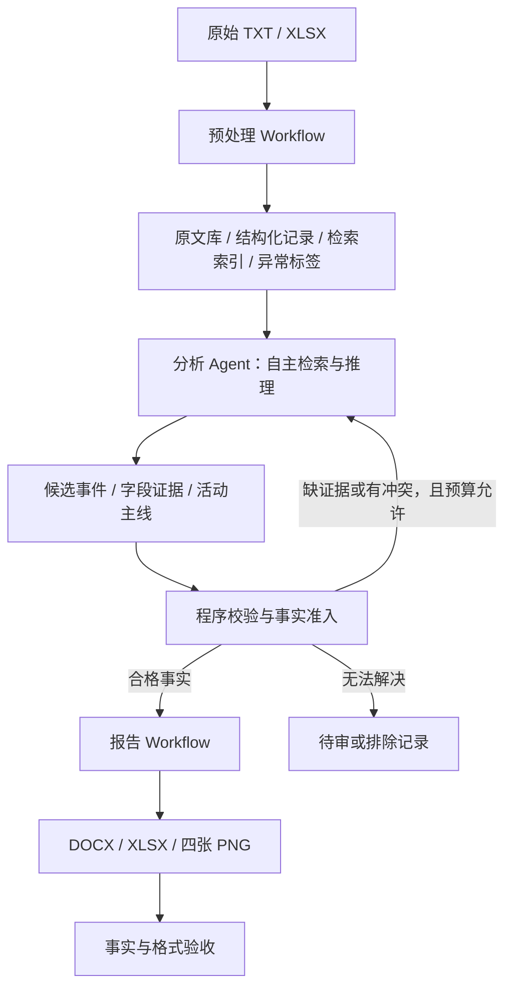

# Workflow + Agent 多源事件分析与日报生成方案（第一版）

## 1. 方案目标与当前依据

采用“预处理 Workflow → 分析 Agent → 报告 Workflow”的三段架构。前段把 TXT 和雷达 XLSX 整理成可检索、可追溯的证据；中段由 Agent 自主安排理解、检索、关联、冲突核验与跨日分析；后段从核验通过的结构化事实生成日报。

本版依据仓库赛题说明和已有基线代码设计。当前工作区未包含原始数据，尚未验证实际文件规模、字段格式、正文是否多行、重复率和异常分布。文中清洗规则属于待样本验证的设计，不代表已经完成数据分析。

第一版重点验证：Agent 能否比现有规则基线更准确地关联多源事件、处理冲突，同时保留证据链。可信判定暂保留两条候选路线：辩论核验、模型排序与风险分级，不提前确定优胜方案。主分析过程先采用单 Agent；辩论路线可用独立模型调用实现不同角色，是否部署为独立 Agent 后续再定。

## 2. 整体架构

### 与现有 coding agent 产物的对比

下面比较的是 artifact 中最终程序的运行逻辑，不能据此还原当时 coding agent 开发程序的完整过程。

| 环节 | GPT 版本 | Claude 版本 | 本方案 |
|---|---|---|---|
| 文本理解 | 关键词、别名和匹配规则 | 词典、正则、就近抽取 | Agent 阅读原文理解 |
| 事件关联 | 以雷达批号为起点，对文本打分选最高项 | 加权打分、贪心匹配、事件簇合并 | Agent 检索、比较、主动补证 |
| 可信判断 | 支持分数、标题相似度及异常阈值 | 字段投票与异常处理规则 | 辩论或模型排序、risk 分级 |
| 跨日分析 | 固定筛选与阶段划分 | 连续性规则和主线选择 | Agent 结合历史证据分析 |
| 报告正文 | 模板拼接 | 模板拼接，包括“研判”文字 | 模型基于事实表写作 |

现有 artifact 没有保存两次 coding agent 的完整调用记录，因此不能确认它们当时读了多少原始样本、如何迭代；只能确认最终程序的执行逻辑。就这些代码而言，本方案增加了运行时自主调查能力，而不是给现有流水线换个名字。

两版最终程序均不调用外部模型。coding agent 在开发阶段自主选择技术路线，不代表产出的程序在每次处理数据时仍有模型参与。任务所需的抽取、关联、核验、追踪和报告能力相似，区别在于判断发生的位置：旧版将判断写进固定规则，本方案将语义调查和判断留给运行时 Agent，程序负责证据管理、边界和校验。

对外是三个阶段；中间分析阶段包含程序校验和有界反馈循环。Agent 决定调查顺序和证据组合，程序控制数据权限、数值计算、事实准入和交付格式。

## 3. 前段：预处理 Workflow

### 3.1 清洗边界

清洗解决格式问题，输出整理好的证据。事件是否真实、不同来源是否属于同一事件、冲突取值采用哪个，留给分析阶段。

保留不可修改的原始副本；每项转换记录原值、转换值、规则版本和来源位置。异常记录先标记或隔离，不在清洗阶段无记录地删除或改写。

### 3.2 文件盘点与时间隔离

- 运行配置固定赛段、起始日和报告节点日。
- 读取前排除节点之后的文件；检索工具执行相同过滤。
- 记录文件路径、来源类别、目录日期、大小、内容哈希和解析状态。
- 检查每天两类 TXT 与雷达工作簿是否存在，输出缺失清单。
- 目录日期、发文时间、抄收时间、活动时间分别保存；目录日期不直接填成活动时间。
- 当允许范围内的文章提到节点之后的活动时，保留为未来计划线索，不计入已发生事实。

### 3.3 TXT 处理

1. 按 UTF-8/BOM 等明确规则解码，失败记录错误；避免用替换字符掩盖损坏。
2. 解析标题、正文、主题词及明确的时间字段，支持正文跨多行。
3. 保留原文；另建统一换行、无意义空白等格式的文本版本。
4. 按段落或句子建立检索片段，保留文章 ID、片段 ID、上下文及原文定位映射。
5. 原文检索与字段检索并用；别名扩展用于检索，不把歧义名称提前强制统一。
6. 精确重复内容分组；相似文章建立关系，保留每篇来源记录。

不能在清洗阶段删掉信源转述、否定、猜测、数量修饰、时间修饰等内容。例如“据某媒体报道”“可能”“未发现”“至少两架”都可能影响核验。不能把“未发现”作为缺失值，也不能把“至少两架”直接变成精确数量 2。

模型仅用于少量规则无法解析的文件：返回结构化字段、原文定位及失败状态，不补写缺失事实。这类固定抽取调用不需要独立 Agent。

### 3.4 XLSX 与雷达处理

- 读取“飞机”“舰船”工作表，检查实际表头；保留工作表、原始行号和每个原始单元格值。
- 统一字段类型；批号、舷号、呼号按标识符处理，保留前导零。
- 解析完整日期时间；保留原始时间及明确的时区信息，时区未知时不擅自补定。
- 检查时间能否解析、坐标范围、缺失值、数量格式和首末时间顺序。
- 精确重复行建立重复组；相同时间但位置或数量不同的记录保留为冲突。
- 按日期、工作表、批号建立初始轨迹候选，保留全部点序列。批号不被视为全局唯一实体 ID。
- 计算相邻点时间差、距离、速度等指标，标记跳变、数量变化、区域不一致和时间疑点。
- 空间异常阈值按目标类型配置，拿到样本后校准；不能统一用经纬度差阈值裁决。
- 主体与平台不一致先标记，依据带版本的领域词典；未知型号保留未知，不凭模型常识改值。

合法跨日轨迹与错误日期需要区分。轨迹拆分属于候选建议，必须保留原始分组和原因。不能提前对国家、平台、任务或数量取众数作为最终真值，不能用轨迹中位位置替代完整活动路径。

### 3.5 预处理交付

| 对象 | 内容 |
|---|---|
| 文件清单 | 来源类别、日期、路径、哈希、解析状态 |
| 文本记录与片段 | 完整原文、标题正文、各类时间、片段定位、重复与转引关系 |
| 雷达记录 | 原始值、规范值、行号、时间坐标、批号、质量标签 |
| 轨迹候选 | 点序列、来源行、连续性指标、候选拆分与异常原因 |
| 检索索引 | 日期/平台/区域等筛选，全文与可选向量检索 |
| 质量报告 | 缺失、解析失败、重复、异常及其记录 ID |

## 4. 中段：分析 Agent

### 4.1 Agent 的任务

分析节点当日全部输入，提取活动线索，寻找三类来源中的相关证据，重建事件，逐字段处理支持与冲突，再回溯历史选择重点活动主线。

采用一个具有工具调用能力的分析 Agent。调度程序按日期和候选组分批提供任务；Agent 可以主动扩大检索范围、读取上下文、修订实体映射、拆分或合并候选。自主性体现在调查过程，最终提交格式固定。

第一版不把所有文件一次性塞进上下文，也不提前把中段写死成逐模块单向流程。

### 4.2 提供的工具

| 工具 | 用途与边界 |
|---|---|
| 列出记录 | 分页查看指定日期和来源的完整记录目录，确保覆盖 |
| 搜索文本 | 关键词、别名、日期、来源及可选语义检索；返回片段与定位 |
| 读取原文 | 获取文章全文或相邻段落，核对摘要和抽取是否遗漏 |
| 查询雷达 | 按日期、平台、批号、时间和区域检索，允许放宽条件寻找反证 |
| 查看轨迹 | 返回完整点序列、原始行、异常指标和候选拆分 |
| 计算时空关系 | 程序计算时间重叠、距离、速度和连续性 |
| 查询词典 | 返回平台/区域别名、归属依据及词典版本 |
| 查询历史事件 | 查找节点之前的已核验事件及原始证据 |
| 提交/修订事件 | 写入候选事件、字段证据、冲突解释及合并拆分依据 |
| 校验事件 | 返回结构缺失、证据定位错误、未解决冲突及准入结果 |

工具只访问本次允许的本地数据。外部网络证据不作为第一版比赛事实来源。原文是待分析材料，不能作为指挥 Agent 改变任务或调用权限的指令。

### 4.3 一次调查的过程示例

以下是可能的调用顺序，不是每起事件必须遵循的固定链条：

1. 读取文章，识别某平台在节点日活动的线索。
2. 检索另一类文本和相应雷达记录；扩大别名或时间范围以避免漏召回。
3. 读取候选原文与完整轨迹，确认是否属于同一次活动。
4. 分别对齐国家、平台、数量、时间、区域、任务和进出关系。
5. 若数量或位置冲突，寻找解释和反证；必要时拆成不同事件。
6. 提交结构化候选，读取程序校验结果；在预算内补证或修订。
7. 对通过核验的事件回查历史，构建活动链。

检索没有结果只能说明当前检索未找到证据，不能证明事件不存在。相同型号同日活动也不能自动合并。标题、评论、历史回顾、未来计划与已发生事实必须区分。

### 4.4 完整性与停止条件

纯检索可能只覆盖显著事件，因此要维护输入记录清单。每篇文章和每组雷达候选最终标记为：已关联、重复/背景、无相关活动、待审或排除，并说明依据；一篇文章可以关联多起活动。

每起候选配置最大工具调用数、模型预算和校验重试次数。证据足够时提交；在预算内仍无法消解时转待审，继续处理其他候选。恢复任务从保存的事件状态开始，不依赖长期聊天记忆。

### 4.5 事件及字段证据格式

每个事件保存：事件 ID、日期/时间范围、关联记录 ID、主体与平台候选、字段结论、冲突清单、合并拆分依据及状态。

每个关键字段至少保存以下信息：

| 字段项 | 含义 |
|---|---|
| 原始说法与最终值 | 保留不同表述，区分精确值、范围、下限和未知 |
| 支持证据 | 来源类别、记录 ID、原文片段或雷达行 |
| 冲突证据 | 与该值明确不兼容的说法及位置 |
| 证据关系 | 支持、未提及、可兼容差异、明确冲突 |
| 判定依据 | 为什么采用、暂缓或排除该值 |
| 结果状态 | 已核验、待审、排除 |

证据定位必须可回查；程序检查引文对应原文。定位有效只证明引用真实存在，语义支持是否成立仍需核验和评测。

### 4.6 可信判定：两条候选路线

两条路线接收同一份候选事件与证据包，返回统一的逐字段判定、事件风险、证据缺口和处理建议。可信判定关注“事实错误或证据不足的风险”，不表示军事活动的威胁程度；事件重要性另设字段，不能混入可信排序。

#### 路线 A：辩论核验

设置证成、质疑和裁决三个角色：

1. 证成角色提出最符合证据的事件解释，逐字段列出支持证据和仍存在的缺口；允许得出证据不足的结论。
2. 质疑角色检查错配、重复转引、时间与区域冲突、异常雷达及可替代解释，必要时检索反证；不能为了反对而虚构矛盾。
3. 双方针对具体字段交换一轮质疑与回应，可补查原文和轨迹。
4. 裁决角色回看原始证据，判定哪些质疑已解决、哪些仍未解决，输出字段结论、风险等级和纳入/待审/排除建议。

双方首轮独立阅读同一证据包，不先看对方结论。以固定轮数和预算停止，不以“双方达成一致”为真实性标准。裁决比较证据，不比较措辞或论证篇幅；缺少关键证据时保留未知。

可能收益是暴露遗漏与替代解释；待验证的代价是更多调用、裁决偏差以及多个角色重复同一种错误。角色不同不构成新的数据来源，三位模型一致也不能替代三源核验。

#### 路线 B：模型排序与风险分级

模型先逐事件、逐字段评估证据充分性与冲突，再对事件做可信程度排序。一个事件存在多个解释时，同时排列这些解释，给出最优解释及其相对次优解释的证据优势。

建议第一版采用可解释的等级，而非直接要求模型给出“真实概率 95%”：

| 等级 | 判定含义 | 建议处理 |
|---|---|---|
| 低风险 | 关联依据清楚，关键字段有支持，未见未解决的关键冲突 | 提交程序准入检查 |
| 中风险 | 存在证据缺口或歧义，需要进一步确认关键字段 | 补查证据或待审 |
| 高风险 | 存在未解决的关键冲突、明显错配或依赖异常记录 | 优先核查；未消解前不纳入 |
| 无法评估 | 输入不足或损坏，无法支持有效比较 | 修复输入或待审，不强制排序 |

模型输出 `risk_level`、`risk_reasons`、`field_risks`、`missing_evidence`、`alternative_explanations`、`rank` 和处理建议，各项依据引用证据 ID。没有关键冲突但证据不足的事件仍不能自动标低风险。

绝对风险等级和相对排序分开：一组候选中排名第一的事件也可能全部不可信；不得按固定比例强行选入前若干名。关键字段高风险不能被其他字段低风险平均掉。若增加数值分数，先作为排序分数，未经标注集校准不解释成概率。

可能收益是接口简单、成本较低并能安排复核优先级；待验证的问题是模型自评偏高、排序受输入顺序影响，以及低风险标签是否对应低实际错误率。

#### 共用输出与路线选择

共用输出保留判定方法、版本、事件与字段风险、原始证据引用、未解决问题和处理建议。来源关联、字段正确性与推断合理性分别检查，不用一个总分掩盖不同类型的风险。

第一版分别运行 A、B 做对照，不先把两者串联。后续可以验证“B 全量分级，A 复核中高风险及随机抽取的低风险事件”；抽查低风险事件是为了发现 B 漏掉的问题。是否采用组合方案由质量与预算结果决定。

### 4.7 事实准入

按仓库现有判定口径执行：三类来源能够关联到同一事件；关键事实至少得到两类来源支持；第三类没有无法消解的明确冲突。雷达没有无条件优先级。

辩论路线或排序路线提交证据、风险和语义判断，程序检查来源类别、必填字段、证据引用、冲突状态和准入条件。低风险标签、最高排序或辩论通过均不直接等于准入。关键字段清单固定在配置中，不能由 Agent 为某起事件临时缩减。

程序校验依赖 Agent 对证据关系的判断，因此通过结构校验不等于保证事实正确。第一版通过人工标注样本和定向复核衡量语义核验质量。待审事件保留在内部结果中，不自动进入标准日报。

### 4.8 跨日分析

从节点日仍出现的外方或台湾三海活动中选择主线，只查询赛段起始日至节点日的历史证据。合格重点主线至少覆盖三个不同日期，概括为两至三个阶段。

相邻证据间隔不超过 7 日通常视为连续；8—14 日可归为同一主线但区分阶段；15 日及以上通常作为新线索。时间间隔只是辅助，还要核对主体、平台、区域和活动关系。没有合格主线时明确记录证据不足。

事实与推断分别存储。分析结论引用事件 ID；不同日期的同型平台活动不能仅凭型号认定为同一架飞机或同一艘舰船。

## 5. 后段：报告 Workflow

输入限定为已准入事件、活动链、分析结论和程序统计。写作模型只能使用这份报告材料包；缺失事实返回分析阶段补证，不能自行补齐。

1. 程序按事件与明确的架/艘次口径去重、汇总。雷达行数不是架次或艘次，数量缺失也不能默认填 1。
2. 按固定章节组织材料；模型生成事实陈述和有依据的分析，内部保留句子与事件 ID 的对应关系。
3. 程序生成 DOCX、XLSX 和四张 PNG。
4. 核对正文数字、明细表、图表与同一份事实表一致；检查新增实体、无来源结论和时间越界。
5. 验证文件可打开、章节齐全、表头与命名正确，失败时输出错误清单并阻止交付通过。

交付遵循仓库规范：DOCX 包含当日总览及五个规定章节；XLSX 仅有“飞机”“舰艇”两表，分别固定 16 列和 11 列；生成四张规定 PNG，正文引用全部图表。除重点态势分析章节外，内容只反映节点当日。

地理示意图需区分真实坐标与区域示意位置；内部证据和调试信息放在独立中间结果中，不增加交付 XLSX 的工作表或列。

## 6. 第一版实现范围与复用

| 模块 | 第一版做法 |
|---|---|
| 文件解析 | Python 确定性读取；保留原文、单元格和位置 |
| 清洗与质量标签 | 明确规则；少量格式解析失败用固定模型抽取 |
| 检索 | 日期/来源/平台过滤加全文搜索，按样本表现决定是否增加向量检索 |
| 雷达候选 | 初始分组与连续性计算；保留完整点和异常候选 |
| 核心理解 | 单个分析 Agent，通过工具自主调查事件 |
| 可信判定 | 辩论核验与模型排序/风险分级两条路线分别评测 |
| 准入与统计 | 程序规则校验和确定性计算 |
| 报告 | 固定模板、受事实包约束的模型写作、程序生成文件 |
| 状态保存 | JSONL/SQLite 等本地存储，保存配置、模型版本、调用记录及检查点 |

沿用 Claude 基线中的词典、解析与报告模块作为起点，具体调整如下：

- `extract.py`：完整保留原文与信源措辞；支持多行正文；规则抽取结果作为候选而非最终事实。
- `radar.py`：保留异常行、全部点和字段不同取值；众数不直接作为最终值；轨迹候选拆分带依据。
- `fusion.py`：保留可复用的候选查找能力，事件关联与冲突判断由 Agent 调查，配合程序准入。
- `tracking.py`：复用时间间隔和活动链辅助计算，主线结论绑定核验事件。
- `report.py` / `charts.py`：调整为读取统一的已准入事实包，增加一致性验收。

上述旧基线文件未原地改造，也未实测现有模块的全部能力。第 10 节记录了本方案在独立目录中的第一版实现与复用边界。

## 7. 实施与验证顺序

### 第一阶段：真实数据盘点与小样本标注

拿到原始路径后，盘点所有文件；抽查两类 TXT 和两类雷达表，确认字段、时间格式、正文结构、轨迹规模和异常情况。选择普通事件、同型平台多活动、转载、数量冲突、雷达跳变、跨日活动等样本，人工标注事件边界和字段证据。

### 第二阶段：跑通一个节点

实现无损预处理、工具接口、单 Agent 调查、事件校验与状态保存。先检查事件表及证据链，再接入报告生成。跨日样本应包含足够历史日期以验证重点主线。

### 第三阶段：对照评测并扩展全部节点

在同一标注集和相同数据边界下比较现有规则基线与 Workflow + Agent。条件允许时增加固定模型抽取流程作为对照，判断收益来自工具调查还是单纯模型理解能力。

可信判定另外设置 A/B 对照：先固定候选事件、原始证据包和准入规则，分别运行辩论与排序/风险分级。记录各自额外检索得到的证据；在相同预算下比较质量，也报告自然运行时的成本与耗时。使用相同标注样本并多次运行，检查排序对输入顺序的敏感性和辩论裁决的稳定性。调参样本与最终验证样本分开。

除了总体事件准确率，还要比较低风险事件的实际错误率与覆盖率、严重错误漏检率、待审比例，以及排序靠前候选的精确率。严重错误包括事件错配、数量/时间/区域关键错误和异常雷达误采信。不能只靠大量拒绝事件得到高准确率；也不能仅凭辩论后的模型一致性判断提升。

重点指标：

- 事件精确率、召回率，以及错误合并/拆分数量；
- 国家、平台、数量、时间、区域、任务等字段准确率；
- 冲突处理、异常雷达采信、来源定位和活动主线正确性；
- 输入覆盖率、未来信息泄漏和待审事件比例；
- 报告完整性、事实一致性、格式合规；
- 每节点工具调用数、模型成本、耗时及重复运行结果波动。

保存输入哈希、模型标识、提示词版本、规则/词典版本、生成参数和工具返回结果，以便重放与定位错误。固定配置和缓存能改善复现，不能保证外部模型每次生成完全相同。

达到“一个节点端到端可运行、事件可反查、主要错误可归因、交付检查通过”后，再扩展至全部节点。具体准确率与预算目标在完成标注和基线测量后设定，不预先承诺 Agent 一定提高成绩。

## 8. 待原始数据确认的事项

1. 数据路径、日期跨度、每天文件与雷达点数量。
2. TXT 字段是否固定，正文是否多行，是否存在编码损坏。
3. 雷达字段实际类型、批号复用、时间含义及跨日记录规则。
4. 报道之间的转引关系与独立支持应如何认定。
5. 可用模型/API、调用预算、比赛允许的外部资源及复现限制。
6. 架次、批次、艘次等统计口径与官方示例的一致性。

## 9. 第一版建议

前段尽量无损、确定性地准备证据；中段由分析 Agent 调查事件，可信判定分别尝试辩论核验与排序/风险分级；后段围绕结构化事实完成统计、写作与格式交付。两条可信路线共用证据结构和准入接口，先比较实测效果，再决定采用哪条或按风险组合使用。

## 10. 第一版代码落地（2026-10-08）

代码位于 `artifact/20261008_workflow_agent_v1/`，运行说明见该目录 `README.md`。实现了无 API 预处理、本地证据库、运行时工具调用调查、risk/debate 两条可信路线、程序准入、基于事实包的报告写作与 DOCX/XLSX/PNG 输出。DS/GPT 的兼容接口和 Claude 原生接口均预留，实际地址、模型名和密钥待提供；各角色可分别指定模型。

当前只使用合成数据与脚本化模型响应验证工程行为，没有调用真实模型，没有原始数据效果和比赛成绩。已覆盖引文伪造拒绝、未来日期隔离、原文和批号保留、复制证据检查、冲突门控、两种可信路线、工具预算与参数修复，以及合成端到端交付和续跑。

后续接入记录（2026-10-08）：DS 密钥已存入被 Git 忽略的本地环境文件，未写入本文或代码。已查询实际可用模型，并使用 `deepseek-v4-pro` 完成一次关闭思考的真实工具调用与结果回传测试；共 482 tokens，仅验证连通性和工具协议。当地配置暂将调查、risk、证成、裁决和写作角色指向 DS；GPT/Claude 接口和原始数据端到端效果待验证。

代码仍有明确边界：关键词召回尚无向量索引，来源独立性只做精确复制检查，主线限定同一标准主体/平台，专用事件拆分与来源重新分配工具待补。报告数值和引用校验不能证明语义正确，后三张图目前为区域矩阵示意，尚未对齐官方地图样式，DOCX 页面视觉验收未完成。接入真实 API 和原始样本后再测准确率、召回率、风险分级效果、成本与格式。

### v1.1 运行与追踪

2026-10-08 已拉取原始初赛数据（80 天）。抽查每天两类 TXT 各 50 篇、飞机和舰船雷达表各 300 行。首轮选择起始日 2025-05-01 至首节点 2025-05-10，DS `deepseek-v4-pro`、关闭思考、risk 路线。

实验目录按 `artifact/北京时间戳_方案版本_模型名称_可信路线/` 命名。保留代码/配置/输入指纹、原始副本、事件与修订、覆盖记录、完整模型请求响应和工具 trace、时间与用量、重试和失败信息，并生成 trace 汇总。密钥不进入代码快照、配置、日志或 trace。

实际数据中一条轨迹对应多行雷达点，v1.1 按轨迹组调查，保留所有点并记录组覆盖，避免逐点重复模型调用。写作可分页读取已准入历史。已完成 25 项工程测试；真实节点结果另存实验目录，不把过程启动或测试通过视为内容准确性验证。

## 2026-10-08 真实数据启动记录（v1.2）

原始数据已从 origin/main 拉取，首节点为2025-05-10，读取2025-05-01至节点日。预处理得到7000条记录、527组轨迹，安排1527个调查任务。v1.1两任务试跑产生一条候选事件，但均触发100000字符上下文预算；记录已保存，不能视为可信结果。v1.2将预算提高至500000字符、80次工具调用、24轮；显式完成调查与事件可信状态分开，预算/API中断仍保留未完成。26项测试通过。

完整节点以DeepSeek deepseek-v4-pro、risk路线后台启动，输出目录：`artifact/20261008_204853_747_workflow-agent-v1.2_deepseek-v4-pro_risk`。完整日报只有调查覆盖与校验通过后才会生成，启动不代表报告完成。目录保存原始副本、代码快照、配置、逐次模型和工具调用、用量、时延、错误、检查点和最终结果；不保存API密钥。辩论路线尚未运行。

## 源码对照后的效率诊断（v1.3）

GPT的build_events按日读取文本、按雷达批号聚合后评分匹配；Claude的process_day先抽取mentions、生成tracks、link_day贪心关联并合并，events_by_day复用每日结果。二者均无运行时模型请求。当前Agent调度按1000篇文本与527组轨迹逐个串行启动，相关线索可能重复发起调查；检索工具每次反序列化全量记录，历史日未先建立可复用事件摘要。

真实trace抽样：启动8个任务时已有107次模型响应、226次工具调用、47次finish_seed；已结束任务平均约133秒，模型响应平均约8.65秒。read_record共94次，对应94个不同记录，不能据此声称重复读同一记录。明确缺陷是finish_seed成功后没有终止循环；v1.3增加终止条件，处理完该轮工具后立即退出，测试覆盖不请求下一轮。现有v1.2进程已加载旧代码，不会因源码修复自动改变行为。

后续调度应以日期内事件线索包为单位，候选关联只用于检索组织、保留原始证据和未匹配线索，不把旧版规则结论当真值；模型自主决定拆并、补证和冲突处理。历史日期形成可复用摘要，独立任务可受限并发。降低调用数量的效果需新实验验证，不能以规则基线耗时推断Agent耗时。
